# week9 - Note REST CRUD (Spring Data JPA + MariaDB)

- Render Deployment URL: <!-- TODO -->
- GitHub Repository URL: <!-- TODO -->

## ① 프로젝트 소개

### 주제 및 주요 기능
<!-- TODO -->

### Entity 필드 구조
| 필드 | 타입 | 설명 |
|---|---|---|
| id | Long | |
| title | String | |
| content | String | |
| author | String | |
| category | String | |
| hashTag | String | |
| createdAt | Instant | |

### 프로젝트 구조 및 개발환경
<!-- TODO -->

## ② Database SQL Practice

### 기존 Table(book) 조회 및 데이터 추가
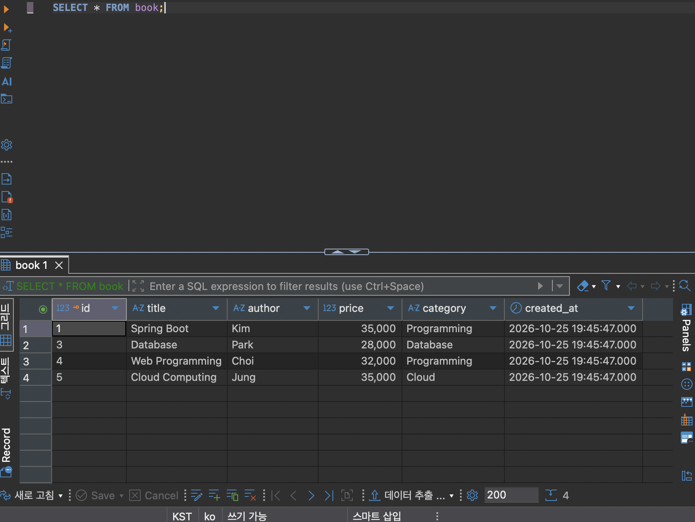
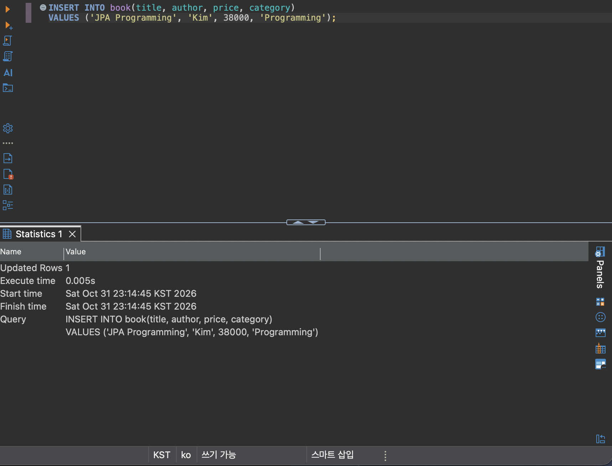
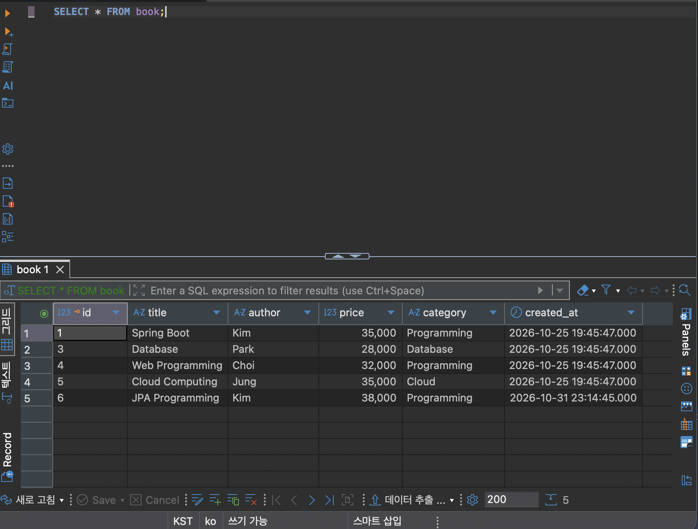

### 새 Table 생성 (movie_sql)
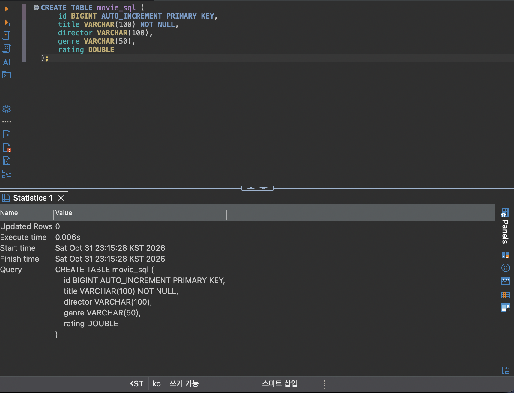

### INSERT
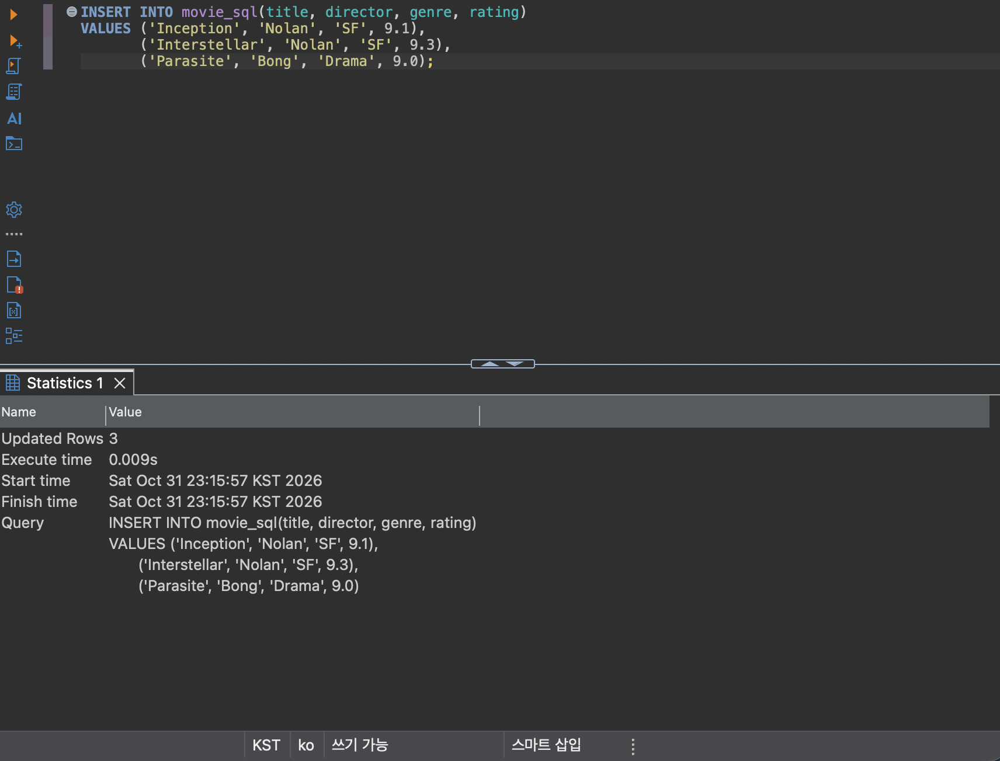
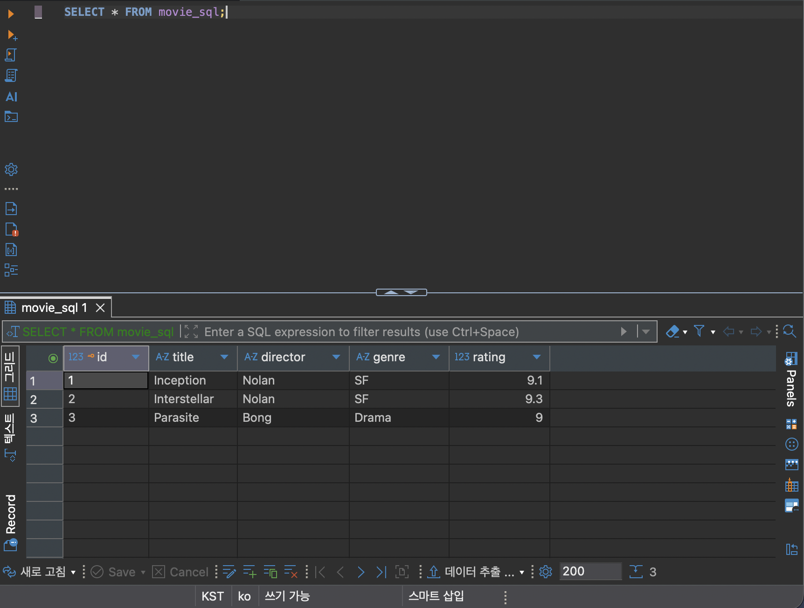

### UPDATE
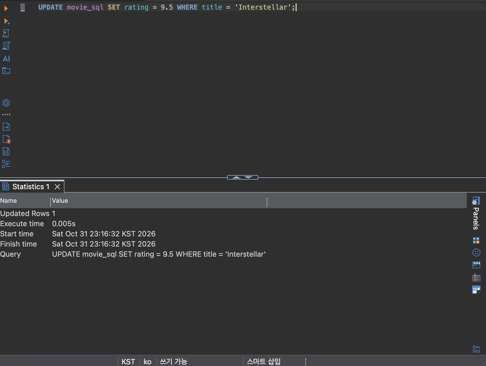
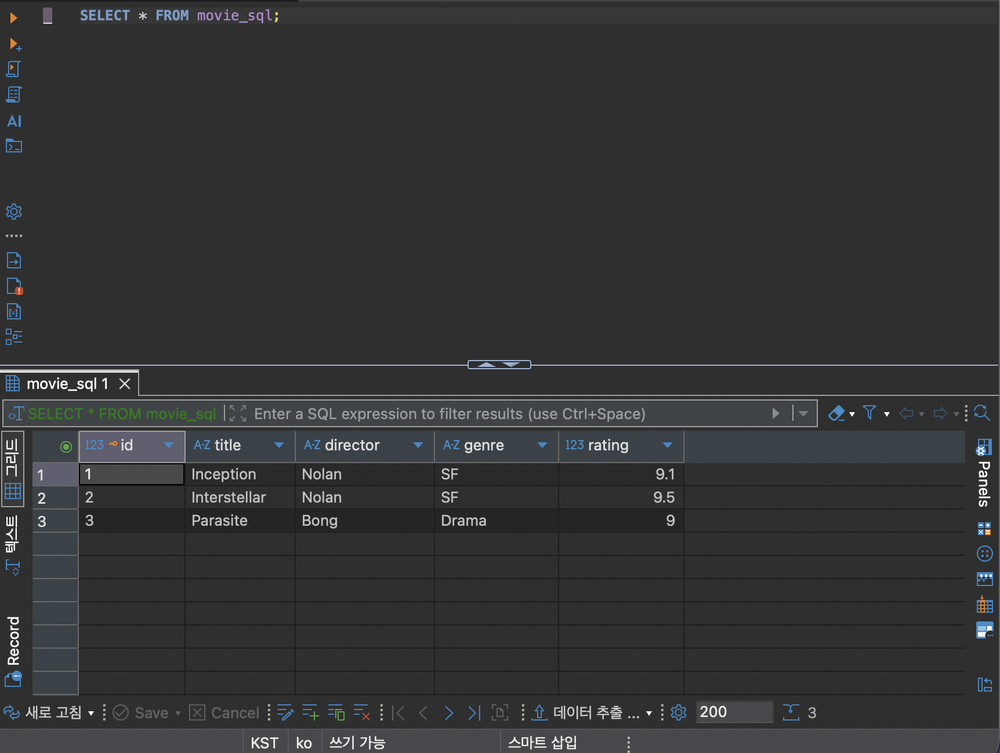

### DELETE
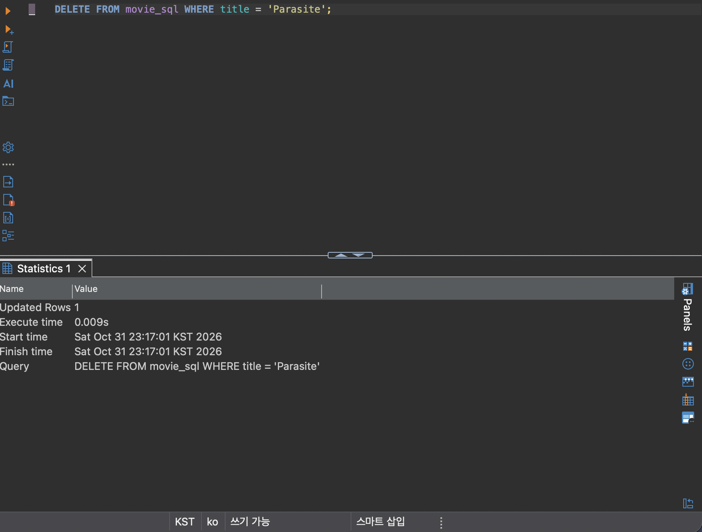
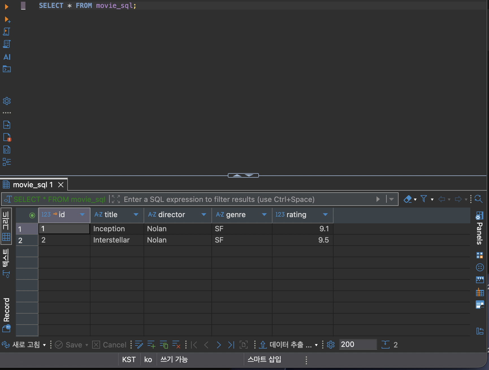

### SELECT
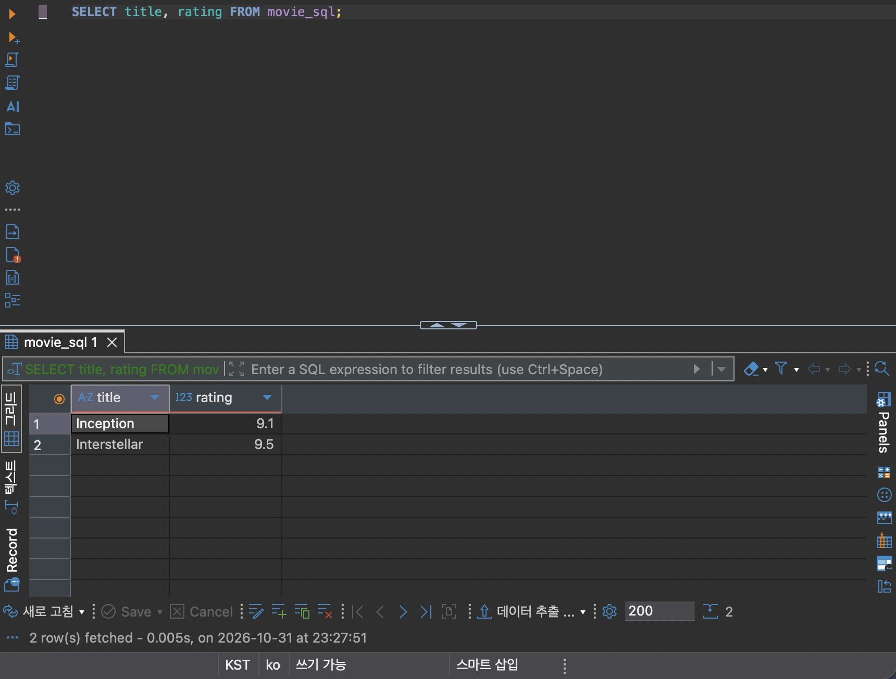
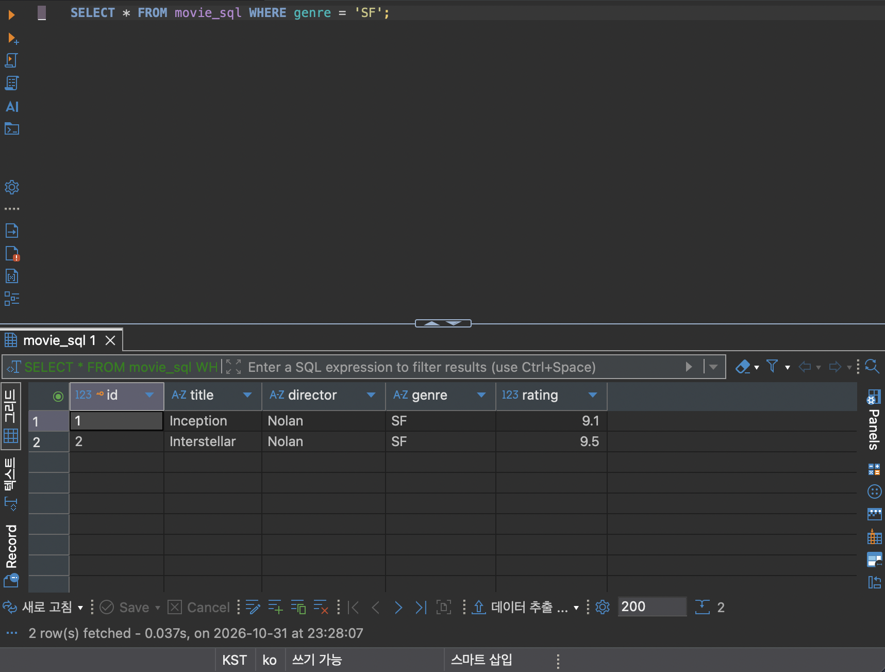

## ③ Spring Data JPA 구현

### Entity 및 JpaRepository
<!-- TODO -->

### 사용한 Annotation의 역할
<!-- TODO -->

### REST API Endpoint
| Method | URL | 설명 |
|---|---|---|
| POST | /api/v1/notes | |
| GET | /api/v1/notes | |
| GET | /api/v1/notes/{id} | |
| PATCH | /api/v1/notes/{id} | |
| DELETE | /api/v1/notes/{id} | |

<!-- TODO: 요청·응답 JSON -->

### JPA Entity와 MariaDB Table 비교
<!-- TODO -->

## ④ JPA와 SQL 비교

### save(), findAll(), findById(), deleteById() 사용 결과
<!-- TODO -->

### 실제 Hibernate SQL
<!-- TODO -->

### SQL 직접 작성 방식과 JPA 방식의 차이
<!-- TODO -->

## ⑤ 배포 및 환경 설정

### 환경변수 (변수명만)
<!-- TODO -->

### Render 배포 과정
<!-- TODO -->

### 배포 URL CRUD 테스트 결과
<!-- TODO -->

### MariaDB 데이터 저장 확인
<!-- TODO -->

### 발생한 문제와 해결 방법
<!-- TODO -->

## ⑥ Weekly Report

### Key Learning
<!-- TODO: 3가지 -->

### Problem & Solution
<!-- TODO -->

### Code Review
<!-- TODO -->

### AI Usage
<!-- TODO: 활용 내용, 직접 수정·검증한 부분, AI 사용률(%) -->

### Reflection
<!-- TODO -->
